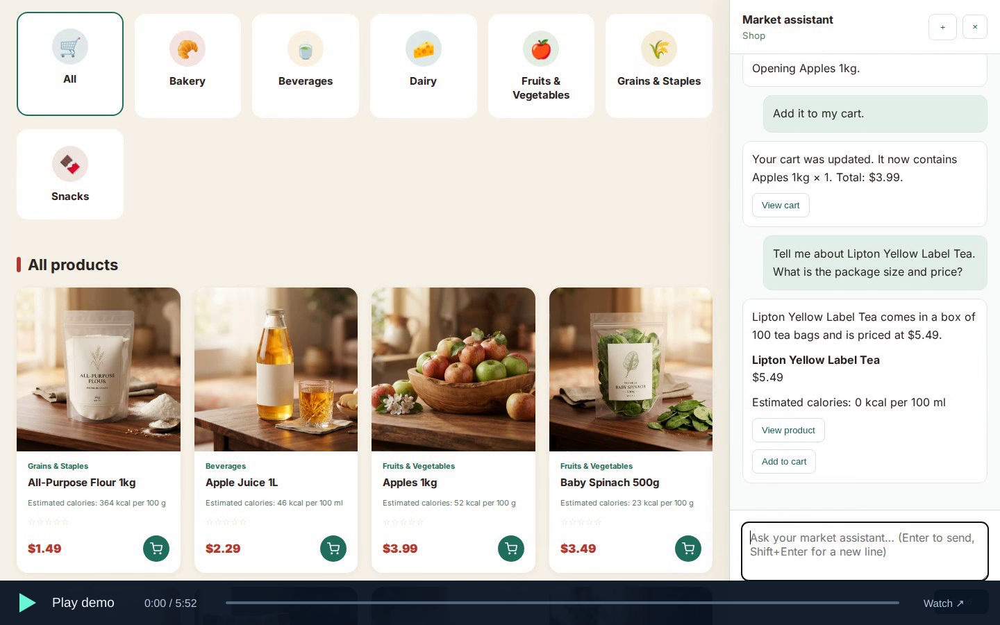

# MarketDeepAgent

MarketDeepAgent is a grocery marketplace with an AI shopping assistant. A customer agent coordinates retrieval and cart specialists to help shoppers research products, compare prices and nutrition, navigate the store, manage their cart and confirm orders.

[](https://bmaged23.github.io/MarketDeepAgent/demo.html)

**[Watch the customer demo · 5 min 52 sec](https://bmaged23.github.io/MarketDeepAgent/demo.html)** — Product research and a five-product order with live agents. Click the play control at the bottom-left of the preview to open the hosted video player.

**English · USD · Ollama Cloud · BGE embeddings · SQLite · Qdrant · BM25**

[Animated architecture](https://bmaged23.github.io/MarketDeepAgent/) · [Database ERD](docs/database.md) · [Customer tour](https://bmaged23.github.io/MarketDeepAgent/demo.html) · [Recording guide](docs/record.html)


## What it does

The customer coordinator delegates product research to the retrieval agent and shopping operations to the cart agent. Retrieval combines SQLite FTS5/BM25, BGE/Qdrant vectors and validated structured catalog queries. SQLite is authoritative for prices, stock, carts and orders. No model-authored raw SQL is executed.

Customers can research products, compare prices and nutrition, navigate the store, adjust carts and request checkout. An authenticated confirmation form creates orders atomically and prevents duplicate stock deductions. Conversation history and explicit owner-filtered preference memory are separate. Payment gateways and automatic carrier tracking are not implemented; prices, calories and ratings in the seeded catalog are demonstration estimates.

## Models and hardware

| Component | Configuration |
|---|---|
| Agent LLM | `gpt-oss:120b` on Ollama Cloud |
| Answer judge | `gemma4:31b` on Ollama Cloud; separate correctness and faithfulness calls |
| Local embeddings | `BAAI/bge-large-en-v1.5`, normalized 1024 dimensions |
| Model revision | `d4aa6901d3a41ba39fb536a557fa166f842b0e09` |
| Native GPU runtime | PyTorch 2.6.0+cu124, sentence-transformers 5.1.2, Transformers 4.57.6 |
| Portable image | Linux amd64, Python 3.12.15, CPU embeddings and bundled model/catalog |

Native GPU inference was verified on a GTX 1660 Ti with 6 GB VRAM and driver 560.76. The portable image uses CPU; a GPU container is not certified. Cloud LLM weights do not consume local RAM/VRAM. Budget at least 8 GB available RAM and 8 GB free disk for CPU, with more space for CUDA libraries. Hardware and platform compatibility are limited to the routes actually verified.

## Measured performance


| BGE configuration | Warm median/query | Warm p95 | Queries/s | Peak process RAM | Peak CUDA allocation |
|---|---:|---:|---:|---:|---:|
| CPU, batch 1 | 231.53 ms | 290.12 ms | 4.27 | 1586.7 MiB | — |
| GPU, batch 1 | 23.87 ms | 41.51 ms | 36.82 | 1964.5 MiB | 1288.9 MiB |
| GPU, batch 8 | 6.48 ms | 8.25 ms | 147.17 | 1936.3 MiB | 1293.6 MiB |

The same 20 queries were encoded three times per configuration. GPU single-query median was **9.70× faster**. Batch 8 is an amortized throughput benchmark, not interactive response latency or a claim that the UI batches eight shoppers. These worker measurements are separate from whole-agent performance. [CPU/RAM/VRAM, cloud bottleneck, token usage and reproduction](docs/PERFORMANCE.md).

## Agent evaluation

A frozen **100-scenario** regression dataset covers 30 retrieval cases, 25 cart cases, 25 coordinator cases and 20 six-turn shopping journeys. References precede model execution: stable product IDs, catalog facts, constraints, initial states, expected actions and expected cart/order effects. Intermediate decisions, tool inputs/outputs, filters, SQL evidence and database changes are checked alongside final answers.

The original source/GPU baseline passed **91/100** workflows: retrieval 27/30, cart 23/25, coordinator 23/25, journeys 18/20. Direct hybrid retrieval on the 30 starter-labelled questions achieved recall/MRR/nDCG@5 of 1.0 and precision@5 of 0.2467. Sparse positive labels and known-catalog questions limit interpretation; this is not universal perfect search accuracy.

Baseline judging covered **145 replies and 290 valid assessments**: correctness **88.79%**, completeness **91.72%**, relevance **95.17%**, faithfulness **94.83%**. These are normalized rubric means, not percentages of conversations passed. The set is synthetic and source-validated, not independently human-adjudicated traffic. Valid low scores are retained.

Baseline failures informed fixes for retrieval planning, review context, checkout routing and original cart instructions during delegation. **The released Docker CPU image and native GPU run each passed 100/100 workflows.** Released-image judging covered 145 replies / 290 valid assessments: correctness **90.34%**, completeness **93.10%**, relevance **95.00%**, faithfulness **95.69%**. These are regression results and normalized rubric means, not guaranteed real-world accuracy. Native peak worker RAM was **2029.2 MiB**, with observed whole-device peak VRAM **1463 MiB**. [Per-agent latency and resource results](docs/PERFORMANCE.md). **Release evaluation runs inside the built Docker image before publication**, using isolated SQL and Qdrant. [Methodology](docs/EVALUATION.md) · [Frozen references](evaluation/README.md) · [Release evidence](docs/RELEASE_VERIFICATION.md).

## Docker: pull, configure and run

The verified public image is [`bmaged23/market-deep-agent:cpu`](https://hub.docker.com/r/bmaged23/market-deep-agent). CI published the gated image, pulled it publicly and repeated its smoke checks. [Exact release and digest](docs/RELEASE_VERIFICATION.md). No repository clone, compilation or Python installation is needed for this route.

Download the two small configuration files:

```bash
mkdir market-deep-agent
cd market-deep-agent
curl -fL https://raw.githubusercontent.com/bmaged23/MarketDeepAgent/main/docker-compose.yml -o docker-compose.yml
curl -fL https://raw.githubusercontent.com/bmaged23/MarketDeepAgent/main/.env.example -o .env
```

Edit `.env`: provide `OLLAMA_API_KEY` and an account-accessible `OLLAMA_MODEL`. Generate `ADMIN_API_KEY` if you need administration endpoints. Then:

```bash
docker compose pull
docker compose up -d
docker compose logs -f market
```

The image includes pinned BGE weights, product images and the 100-product seed. On first start it initializes an empty catalog and indexes it; existing nonempty catalogs are preserved. Open **http://localhost:8600**, register and sign in. API documentation is at **http://localhost:8600/docs**. `/healthz` checks liveness; `/readyz` checks local catalog/index/inference, not cloud account access.

Try “Find apples and apple juice,” add an identified product, inspect your cart and request checkout. A chat reply alone cannot confirm an order.

```bash
# Stop while keeping persistent data:
docker compose down
# Update:
docker compose pull
docker compose up -d
```

Avoid `down -v` unless you intend to delete stored data. [Docker details and troubleshooting](docs/DOCKER.md).

## Source installation, including GPU

Use Ubuntu/WSL, Python 3.12 and Docker Compose. No frontend npm build is required.

```bash
git clone https://github.com/bmaged23/MarketDeepAgent.git
cd MarketDeepAgent
python3.12 -m venv .venv
source .venv/bin/activate

# CPU:
python -m pip install -r requirements.txt
# Or use this instead for a compatible CUDA 12.4 GPU:
# python -m pip install --extra-index-url https://download.pytorch.org/whl/cu124 -r requirements/gpu.txt
python -m pip check
cp .env.example .env
```

Set your cloud key in `.env`, set `QDRANT_URL=http://localhost:6335`, and choose `EMBEDDING_DEVICE=cuda` for GPU or `cpu` for CPU. Source inference downloads the pinned BGE model once; Docker already bundles it.

```bash
docker compose -f docker/compose.storage.yml up -d
python data/seed_products.py
python -m app.product_indexing.commands index-all
python -m app.product_indexing.commands process --limit 100 --force
python -m app.product_indexing.commands status
python -m uvicorn app.main:app --host 127.0.0.1 --port 8600
```

A fresh seed/index should report 100 done and 0 failed. In a second activated terminal run `python -m app.product_indexing.commands watch` to synchronize catalog changes. Each process loads its own model only when needed.

## Tests and CI/CD

```bash
# Lightweight test environment; no model/CUDA download:
python -m pip install -r requirements-dev.txt
python -m pytest -q
# Node.js 24; no npm packages needed:
node --test --test-isolation=none tests/frontend/*.test.cjs
```

CI checks Python 3.12/3.13, frontend behavior, generated diagrams, frozen references and publication boundaries. Trusted code pushes follow:

**Tests → build candidate → 100 cases inside that image → separate answer judges → coverage/quality/safety gate → container/persistence checks → publish exact gated image → pull and test again.**

The seeded catalog and bundled model support GitHub-hosted CPU evaluation without access to a laptop database. Keys are encrypted GitHub secrets. Pull requests get offline tests without publishing credentials. Documentation-only pushes avoid another live release. Image delivery is separate from hosting a public website. [CI/CD and quality policy](docs/CI_CD.md).

## Important settings

| Setting | Default / purpose |
|---|---|
| `OLLAMA_MODEL`, `OLLAMA_TIMEOUT_SECONDS` | `gpt-oss:120b`, 120 seconds per call |
| `EMBEDDING_DEVICE`, `EMBEDDING_BATCH_SIZE` | `cpu`, 32; choose `cuda` for native GPU |
| `BM25_WEIGHT`, `VECTOR_WEIGHT` | 0.30 / 0.70, per-list min-max normalization |
| `RETRIEVAL_RESULTS_PER_QUERY` | 3 hybrid results per query |
| `RETRIEVAL_MAX_ROUNDS`, `RETRIEVAL_MAX_SEARCHES` | 3 rounds, 8 searches |
| `RETRIEVAL_SQL_MAX_RESULTS` | 100 rows per SQL page |
| `RETRIEVAL_JSON_RETRIES` | 1 schema repair; no retry of a valid low-quality answer |
| `CART_QUOTE_TTL_SECONDS` | 900; stale/changed quotes cannot confirm checkout |
| `CUSTOMER_HISTORY_MESSAGES` | 20; explicit preference memory remains separately owner-filtered |
| `SESSION_COOKIE_SECURE` | false for local HTTP; enable with HTTPS deployment |

See `app/config.py` and `.env.example`. Administration requires `X-Admin-Key`. Orders use cash on delivery and remain unpaid pending fulfillment.

## Project organization

```text
app/                         Feature services, API routes and agent roles
  agents/{customer,retrieval,cart}/
  model_clients/             Cloud LLM and local BGE adapters
  product_search/            BM25, Qdrant and fusion
  product_indexing/          Durable synchronization jobs
  database/migrations/      Authoritative SQL schema
UI/frontend/                 Storefront HTML/CSS/JavaScript
UI/backend/                  Compatibility entry point
products/images/             Seeded product assets
data/                        Catalog seed/nutrition/pricing; runtime files ignored
requirements/                CPU/GPU/dev/evaluation locks and maintainer inputs
evaluation/{datasets,results}/
scripts/{evaluation,performance,release,runtime}/
docker/                      Dockerfile and storage-only Compose configuration
docs/                        Guides, demo, animated architecture and measured charts
tests/                       Python/frontend regressions
```

Private `description/`, databases, full traces and model caches remain ignored. [Documentation index](docs/README.md) · [Script guide](scripts/README.md) · [Dependency guide](requirements/README.md).
