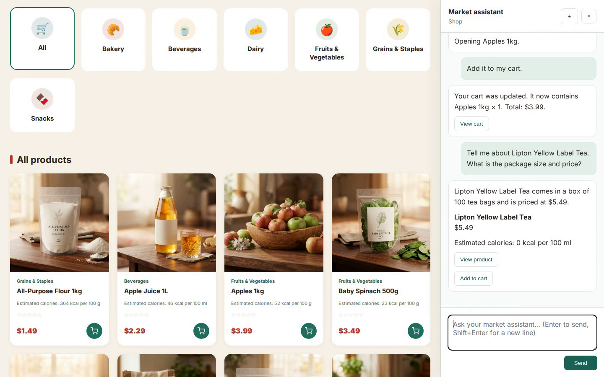
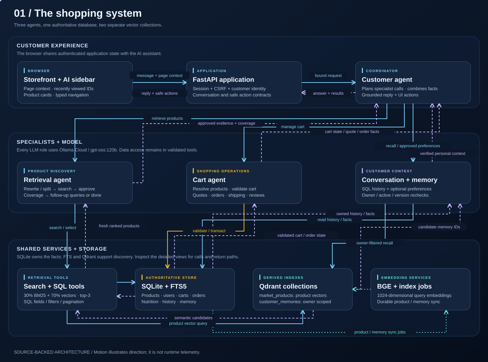

# MarketDeepAgent

<p>
  <a href="https://bmaged23.github.io/MarketDeepAgent/demo.html"></a>
  <a href="https://bmaged23.github.io/MarketDeepAgent/demo.html"></a>
</p>

**[Watch the customer demo · 5 min 52 sec](https://bmaged23.github.io/MarketDeepAgent/demo.html)** — Real storefront, live AI agents, product research and a five-product order.

A grocery marketplace with a page-aware AI assistant. Customers can discover products, ask about product facts, navigate the storefront, update their cart and place orders through a customer coordinator backed by retrieval and cart agents.

**English · USD · Ollama Cloud · BGE embeddings · SQLite · Qdrant · BM25**

[Animated architecture](https://bmaged23.github.io/MarketDeepAgent/) · [Database ERD](docs/database.md) · [Customer tour](https://bmaged23.github.io/MarketDeepAgent/demo.html) · [Recording guide](docs/record.html)



## What works

- 100 seeded products across six categories, with images and explicitly estimated calories.
- Right-side assistant panel, safe Markdown replies, product cards, navigation and shared SQL cart updates. Enter sends; Shift+Enter adds a line.
- Retrieval agent: rewrite/split → hybrid and/or structured SQL search → batch relevance approval → completeness check → follow-up searches or done.
- Cart agent: customer-scoped cart validation, quotes, order history, shipping status and verified product reviews.
- Customer coordinator: conversation, specialist delegation, page context, grounded replies and typed UI actions.
- Cookie sessions, CSRF checks, per-customer conversations and optional long-term preference memory in a separate Qdrant collection.
- Explicit checkout confirmation, cash on delivery, atomic stock deduction and duplicate-checkout protection.

Payment gateway integration and automatic carrier tracking are not implemented. A pending order means it is waiting for fulfillment; unpaid cash-on-delivery does not block fulfillment. Calories are food-type estimates, not verified manufacturer labels.

## Clone to launch

The pinned environment was captured from **CPython 3.13.16 on Linux x86_64**, including all installed transitive and CUDA libraries. Use Ubuntu/WSL with Python 3.13 and Docker with the Compose plugin. The exact snapshot is substantial: allow several GB for dependencies and about 1.3 GB for the embedding model, plus Docker storage. The default embedding device is CPU; the snapshot still includes the installed CUDA packages.

### 1. Clone and create the environment

```bash
git clone https://github.com/bmaged23/MarketDeepAgent.git
cd MarketDeepAgent
python3.13 -m venv .venv
source .venv/bin/activate
python -m pip install -r requirements.txt
python -m pip check
```

If Python 3.13 is not installed, an existing [uv installation](https://docs.astral.sh/uv/getting-started/installation/) can create the tested interpreter/environment instead:

```bash
uv python install 3.13.16
uv venv --python 3.13.16 --seed .venv
source .venv/bin/activate
python -m pip install -r requirements.txt
```

### 2. Configure the application

```bash
cp .env.example .env
python -c 'import secrets; print(secrets.token_urlsafe(32))'
```

Edit `.env`. Set your `OLLAMA_API_KEY` and use the generated value as `ADMIN_API_KEY`. Leave `OLLAMA_MODEL=gpt-oss:120b`, `OLLAMA_BASE_URL=https://ollama.com`, and the default BGE model/dimension unless you intend to reindex. No Venice/Jev account is needed.

For the bundled Compose service, set:

```dotenv
QDRANT_URL=http://localhost:6335
```

### 3. Start Qdrant

```bash
docker compose up -d
curl --fail http://localhost:6335/collections
```

Compose uses port **6335**, bound to loopback, and a named volume. If you already run Qdrant on **6333**, skip Compose and keep `QDRANT_URL=http://localhost:6333` instead. Do not change the URL after indexing unless the other instance has the same collection.

### 4. Create and index the demo catalog

```bash
python data/seed_products.py
python -m app.product_indexing.commands index-all
python -m app.product_indexing.commands process --limit 100 --force
python -m app.product_indexing.commands status
```

The seed command applies all migrations, creates 100 products with stable seed IDs, links the supplied images, and fills demo nutrition. It does not create customer accounts or sample orders and does not duplicate existing product names. The runtime database is intentionally excluded from Git.

SQLite triggers maintain BM25 immediately and enqueue Qdrant work. The first vector indexing run downloads the BGE model; it can take time. Expect `done: 100, failed: 0, skipped: 0` on a fresh catalog and job counts showing 100 done. If jobs fail, resolve the reported dependency/service issue and rerun `process --force` before evaluating semantic search.

### 5. Open the marketplace

```bash
python -m uvicorn app.main:app --host 127.0.0.1 --port 8600 --reload
```

Open **http://127.0.0.1:8600**. Create a customer account, sign in, and click **AI assistant** on the right. API documentation is at **http://127.0.0.1:8600/docs**.

Try: “Show me apples and apple juice,” “Add it to my cart,” “Show my cart,” and “I want to checkout my cart.” Checkout requires the displayed quote, delivery address and explicit confirmation; a chat reply alone cannot authorize payment/order completion.

In a second terminal, keep product vectors synchronized after catalog or stock changes:

```bash
cd MarketDeepAgent
source .venv/bin/activate
python -m app.product_indexing.commands watch
```

The compatibility entry point `UI.backend.main:app` remains available; prefer `app.main:app`. Frontend files are served by FastAPI; no frontend build or npm installation is required.

## Architecture and data

| Component | Responsibility |
| --- | --- |
| Customer agent | Chat, page context, specialist routing, grounded answers and typed UI actions |
| Retrieval agent | Rewrite/split, search, batched approval, coverage and follow-up subqueries |
| Cart agent | Owned cart/order tools, validation and checkout preparation |
| SQLite | Authoritative products, categories, stock, customers, carts, quotes, orders, reviews, sessions, conversations and memories |
| SQLite FTS5 | Persistent BM25 documents synchronized by triggers |
| Qdrant `market_products` | Derived product vectors; point ID equals SQL product_id and category_id is shared |
| Qdrant `customer_memories` | Separate owner-filtered, versioned memory vectors; point ID equals SQL memory_id |
| BGE | Local normalized 1024-dimensional document/query embeddings |
| Ollama Cloud | Planning, rewriting, batched relevance approval, coverage checking and replies |

Hybrid scores use min-max normalization per candidate list:

```text
score = 0.30 × normalized_BM25 + 0.70 × normalized_vector_similarity
```

The retrieval agent defaults to top-3 per hybrid query. SQL selection supports validated filters and field projections, with paginated coverage for whole-category questions. No model-authored SQL is executed. Search refreshes prices, stock and requested product facts from SQL; Qdrant payloads are derived data.

Runtime retrieval evidence stays in memory/API responses. Evaluation reports may be saved. Conversation messages/summaries and explicit customer preference memory persist separately, under the customer's account. Memory recall checks vector owner/model/version filters and then SQL ownership/active/version again.

See the [migration-generated ERD](docs/database.md), [full-size schema SVG](docs/assets/database-erd.svg) and [interactive docs](docs/README.md).

## Configuration

`.env.example` contains the public configuration template; `app/config.py` validates all settings. Never commit `.env`. Important defaults:

| Setting | Default |
| --- | --- |
| `OLLAMA_MODEL` | `gpt-oss:120b` |
| `EMBEDDING_MODEL` / `EMBEDDING_DIM` | `BAAI/bge-large-en-v1.5` / `1024` |
| `DATABASE_PATH` | `data/products.db` |
| `QDRANT_URL` | `http://localhost:6333` (use 6335 for bundled Compose) |
| `BM25_WEIGHT` / `VECTOR_WEIGHT` | `0.3` / `0.7` |
| `RETRIEVAL_RESULTS_PER_QUERY` | `3` |
| `RETRIEVAL_MAX_ROUNDS` / `RETRIEVAL_MAX_SEARCHES` | `3` / `8` |
| `RETRIEVAL_SQL_MAX_RESULTS` | `100` |
| `CART_QUOTE_TTL_SECONDS` | `900` |
| `MEMORY_COLLECTION` | `customer_memories` |
| `CUSTOMER_RECEIPT_MAX_ITEMS` | `10` |

Administration endpoints require `X-Admin-Key`. The default cookie configuration is for local HTTP development. Public deployment needs HTTPS and `SESSION_COOKIE_SECURE=true`.

## Index operations

```bash
# Keyword-only rebuild (no embedding download required)
python -m app.product_indexing.commands rebuild-bm25

# Detect missing/stale vectors and remove orphan product points
python -m app.product_indexing.commands reconcile
python -m app.product_indexing.commands process --limit 100 --force

# Retry queued customer-memory changes
python -m app.customer_memory.commands --limit 100
```

Product writes commit to SQL and queue asynchronous vector work. Failed jobs retry with backoff. Changing embedding dimensions needs a new collection; changing the model/document format needs reindexing. Use product services and migrations rather than directly editing search tables or revisions.

## Tests and evaluation

```bash
python -m pip install -r requirements-dev.txt
python -m pytest -q

# Requires Node.js 24; no npm packages required
node --test --test-isolation=none tests/frontend/*.test.cjs

# Actual workflow with scripted decisions/local test vectors
python -m app.agents.customer.journey_evaluation --offline --repetitions 3

# Live Ollama + hybrid/SQL search; isolated synthetic customers/orders
python -m app.agents.customer.journey_evaluation --repetitions 1

# Per-agent tool input/output reports
python -m app.agents.retrieval.evaluation --max-cases 3
python -m app.agents.cart.evaluation
python -m app.agents.customer.evaluation
```

Evaluation JSON files are saved under **`data/evaluation_reports/`**, excluded from Git. Runtime customer retrieval output is not saved there. Live shopping journeys copy catalog data into temporary SQL and use synthetic customers; they do not create real customer orders or shared memory writes. Offline runs check workflow, not LLM or semantic search quality.

For vanilla retrieval baselines and weighted combinations:

```bash
python -m app.product_search.evaluation --sweep --split tune --limit 5 \
  --weights 0 0.1 0.2 0.3 0.4 0.5 0.6 0.7 0.8 0.9 1 \
  --output data/evaluation_reports/retrieval_vanila.json
```

GitHub Actions checks source syntax, migration-derived diagram freshness, publication exclusions and the 21 frontend/platform/architecture/video checks. Run the full Python suite locally with the pinned test requirements; CI does not install the large CUDA snapshot.

The latest reviewed live journey passed **19/19 checks** and placed two synthetic orders, including stock/idempotence/ownership checks and complete snack calorie answers. This is a small test run, not a claim of comprehensive model quality or a visual browser audit.

## Real storefront demo and animated diagrams

The generated presentation was removed. The replacement records the **actual marketplace browser UI and live multi-agent interactions**, using a temporary catalog-only database and a fictional customer.

```bash
source .venv/bin/activate
npm --prefix docs install
npm --prefix docs run install-browser
python docs/record_storefront.py
```

The recorder shows signup and login at a readable pace, researches prices and nutrition, opens and buys five products (apples, tea, whole wheat bread, Greek yogurt and mixed nuts), changes quantities, confirms one synthetic order and visits order history/profile/settings. Output: **`docs/assets/storefront-tour.mp4`**. It needs working Ollama, BGE and Qdrant. Long waiting periods are trimmed; model replies and rendered screens are never substituted. A failed action aborts the recording rather than claiming success. No real customer/order/stock or shared memory changes occur. Node recording dependencies are separate from the Python environment.

**The actual storefront recording is available:** the completed run produced a 1440×900 H.264 MP4, approximately 5 minutes 52 seconds, using the real UI and live agents with one synthetic order. See [recording details](docs/README.md), including browser dependencies and headed mode.

To view the video and moving architecture/ERD diagrams:

```bash
python docs/generate.py
python -m http.server 8700 --bind 127.0.0.1 --directory docs
```

Open **http://127.0.0.1:8700**. The demo page shows the real MP4 once it exists, with fullscreen and direct playback controls. The [manual recorder](docs/record.html) is also available. The static docs are suitable for GitHub Pages; the marketplace itself needs the Python backend and services.

## Project layout

```text
app/
  agents/{customer,retrieval,cart}/  # Each: agent.py, tools.py, prompts/
  assistant/                       # Authenticated chat orchestration/API
  application_guide/               # Page registry and app help
  authentication/                  # Sessions, identity, CSRF
  products/, cart/, orders/         # Marketplace business features
  customers/, product_reviews/
  product_search/                  # BM25, vector adapter, fusion, evaluation
  product_indexing/                # Durable vector jobs and CLI
  customer_memory/, conversations/
  model_clients/                   # Ollama and BGE clients
  database/migrations/             # Single source of schema truth
  utils/                           # Shared helpers
UI/frontend/                       # HTML, CSS and browser JavaScript
UI/backend/                        # Compatibility entry point
products/images/                   # Product image assets
data/                              # Seed/catalog data and evaluation datasets
                                   # Runtime database/cache/reports are ignored
docs/                              # Diagrams, ERD, demo and recorder
tests/                            # Feature tests and frontend DOM tests
```

Empty `__init__.py` files are intentional Python package markers. `description/` is private, Git-ignored context maintained for coding assistants. The seeded catalog and public docs contain no customer accounts, checkout tokens or private model credentials.

## Publish the demo with GitHub Pages

After pushing the repository, open **Settings → Pages → Build and deployment**:

1. Choose **Deploy from a branch** under Source.
2. Choose branch **main** and folder **/docs**.
3. Click **Save**, then wait for the Pages deployment to finish under **Actions**.
4. Open **https://bmaged23.github.io/MarketDeepAgent/demo.html**.

The README play button opens that hosted video page; the architecture is at the site root. `docs/.nojekyll` serves these static files directly. These links require the one-time Pages setting above.
