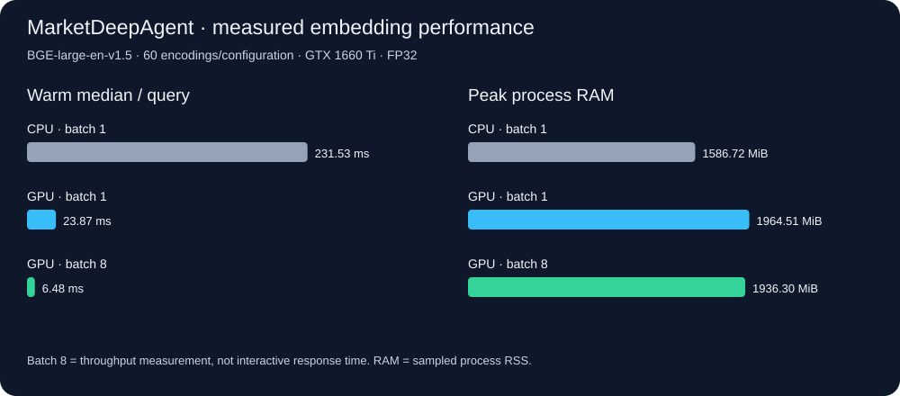

# Performance measurements



## Same-query CPU/GPU comparison

| Configuration | Warm median | Warm p95 | Queries/s | Peak RAM | Peak CUDA allocation | Mean CPU* |
|---|---:|---:|---:|---:|---:|---:|---:|
| CPU · batch 1 | 231.53 ms | 290.12 ms | 4.27 | 1586.7 MiB | — | 197.6% |
| GPU · batch 1 | 23.87 ms | 41.51 ms | 36.82 | 1964.5 MiB | 1288.9 MiB | 100.7% |
| GPU · batch 8 | 6.48 ms | 8.25 ms | 147.17 | 1936.3 MiB | 1293.6 MiB | 106.2% |

GPU single-query warm median was **9.70× faster** in this benchmark. CPU/GPU cosine agreement exceeded 0.99999988 (float32 rounding can report 1.0). Batch 8 timing is amortized; it excludes waiting to accumulate a batch and is not individual-user latency.

*CPU 100% means one occupied logical core. RSS and whole-device GPU observations are sampled; device metrics include other processes. Each process warmed the same 20 queries repeated 3 times, with a separate startup query. Peak RAM includes model initialization. GPU allocation/reservation comes from PyTorch. These are worker measurements, not whole-stack requirements.

## Agent/cloud bottleneck

The 100-case source GPU baseline recorded **607 LLM calls**. Their summed durations accounted for **98.6%** of summed per-case elapsed time, including network/provider wait. Cases overlap across2 workers, so these sums are not experiment wall time. Recorded usage: **1,523,226 input tokens**, **182,161 output tokens**; usage is available on 607/607 calls. No invoice/currency cost is inferred.

The main gpt-oss:120b model is hosted on Ollama Cloud. Local GPU resources are used for BGE, not for a 120B local model. The public portable image uses CPU embeddings; the native CUDA setup is measured separately. GPU embedding speedup is not an equal whole-agent speedup.

## Implementation changes and limits

- BGE weights are pinned and bundled in the candidate image, avoiding a first-run model download.
- Provisioning runs in a short-lived process so its model memory is released before the server starts. The existing per-process model cache avoids repeated loads.
- Current user cart instructions are retained across delegation; owned SQL delivery status avoids unnecessary review clarification. Explicit quote preparation does not authorize checkout.
- Controlled embedding benchmarks and final CPU/GPU workflow measurements are complete. The published container uses CPU; native GPU support is verified separately. No GPU-container or universal compatibility claim.

## Reproduce

```bash
python -m scripts.performance.benchmark_embeddings --device cpu --batch-size 1 --output .release-local/performance/cpu-batch1
# Run these with the CUDA environment:
python -m scripts.performance.benchmark_embeddings --device cuda --batch-size 1 --output .release-local/performance/cuda-batch1
python -m scripts.performance.benchmark_embeddings --device cuda --batch-size 8 --output .release-local/performance/cuda-batch8
python -m scripts.performance.build_report
```

[Machine-readable measurements](performance/measurements.json). Raw vectors and full agent traces stay ignored.

## Final release measurements — 23 October 2026

The exact released CPU image and native CUDA application each passed all **100/100** workflows on the same frozen dataset and application fingerprint. GPU workflows were evaluated separately; the 145-answer rubric evaluation in [the evaluation report](EVALUATION.md) belongs to the released CPU image.

| Scope | Cases | Docker CPU median | Native GPU median | CPU passed | GPU passed |
|---|---:|---:|---:|---:|---:|
| Retrieval specialist | 30 | 14.52 s | 18.68 s | 30/30 | 30/30 |
| Cart specialist | 25 | 3.08 s | 3.88 s | 25/25 | 25/25 |
| Customer coordinator | 25 | 17.43 s | 14.87 s | 25/25 | 25/25 |
| Complete six-turn journey | 20 | 87.02 s | 76.91 s | 20/20 | 20/20 |

A journey includes six actual requests plus deterministic confirmation/ownership/retry checks. Native GPU median across its **120 individual journey turns** was **13.19 s**. These are two-worker regression runs, not a controlled CPU/GPU end-to-end speed comparison: GitHub CPU and local GPU hardware differ, provider load varies, and the cloud judge overlapped part of the native run. Use the controlled embedding benchmark above for the GPU speedup claim.

| Resource observation | Docker CPU worker | Native GPU worker |
|---|---:|---:|
| Peak worker RSS, including startup | 2068.0 MiB | 2029.2 MiB |
| Mean process CPU, one logical core = 100% | 4.02% | 2.44% |
| Observed whole-device peak VRAM | Not sampled | 1463 MiB |
| Observed whole-device peak GPU utilization | Not sampled | 30% |

These averages include cloud/network waiting, which explains low mean CPU utilization; they are not peak compute demand. Worker RSS excludes Qdrant/browser/cloud services. GPU samples include other device users and are not per-agent allocation. Per-case shared-worker samples and intermediate traces remain in the private raw experiment. The interrupted Qdrant-down attempt was preserved and excluded from this healthy run.

[Released CPU aggregate](../evaluation/results/docker-cpu-final.json) · [Native GPU aggregate](../evaluation/results/native-gpu-final.json) · [Release verification](RELEASE_VERIFICATION.md)
