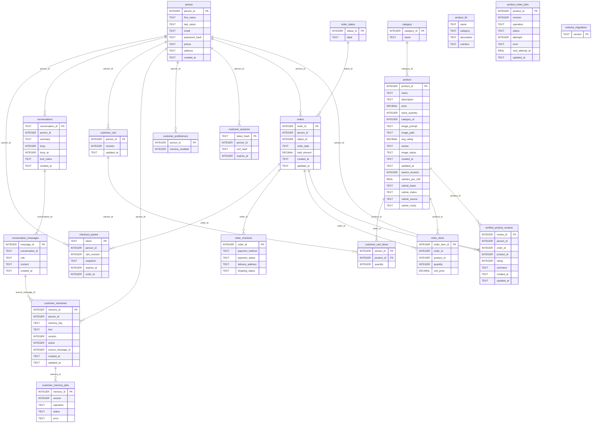

# Database relationships

Generated by `python docs/generate.py` from all six migrations.

FTS shadow tables and sqlite_sequence are implementation details and omitted.
product_fts.rowid logically equals product.product_id. product_index_jobs.product_id is a durable logical reference, not an FK, so deleted products can retain cleanup jobs.

## Qdrant (derived indexes)

| Collection | Point ID | Authoritative join / isolation |
| --- | --- | --- |
| market_products | SQL product_id | payload category_id = SQL category_id; revision, document_hash and embedding_model checked |
| customer_memories | SQL memory_id | payload person_id, version and embedding_model; SQL owner/active/version checked again |

Both collections use 1024-dimensional BGE embeddings with cosine similarity. Qdrant is not a relational store; the links above are logical mappings, not database foreign keys.
